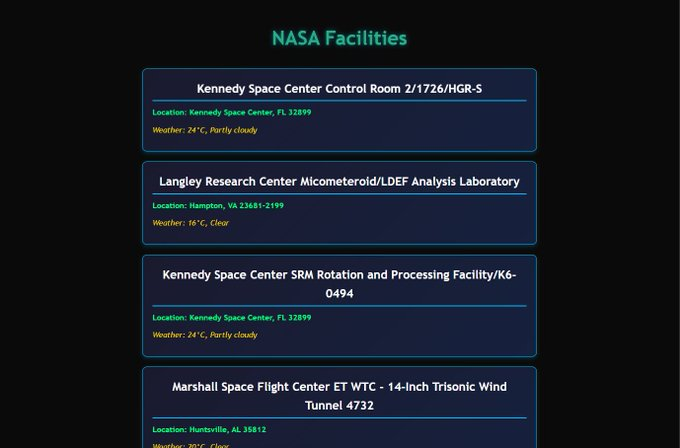

# Complex NASA Project

This project shows NASA facility locations, names, and weather reports!

## How It's Made:

**Tech used:**: HTML, CSS, and JavaScript

I used html for the markup, css for the styling, andI used Javascript for the logic of this project.

## Lessons Learned:

I learned how to interact 2 APIs to return multiple results in a single output. I also learned more about dom manipulation with grabbing data from multiple APIs and turn that data into HTML elements.  

## Image of Project:

