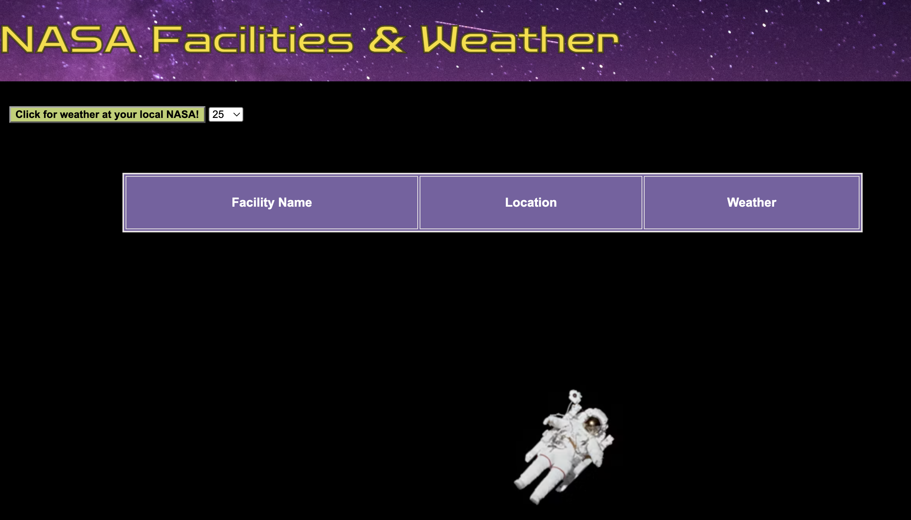

# 🚀 Complex NASA API

An app that uses NASA's API to return all of their facility locations (~400). Faciltiies are displayed in one place along with the name of the facility, its location, and the current weather at the facility. Built with plain HTML, CSS, and JavaScript.

### Project Description

This project is a NASA data app. It gives the user a way to explore a NASA API and a Weather API as public data sources to build a simple website. I built this as part of a learning project to practice working with multiple APIs at once, handling different responses, and keeping a page usable when one request is slow or fails. The styling is a dark retro-space theme to match the subject and because purple is the best color. 

### Live Link 
Access the live link in the About section of this repo or [CLICK HERE](https://priscilla-ruilova.github.io/Complex-NASA-api/)!



### Features:

- **ALL Nasa Facilities on Display** — displays all of NASA's 485 facilities, their names, and the current weather at each facility. The user can choose whether to view 25, 50, 100, or all locations. 

### Tech Used:

- **Frontend:** HTML, CSS, JavaScript (vanilla, no framework)
- **APIs:** [NASA Open API](https://api.nasa.gov/) to get the location of all NASA facilities and api.weatherapi.com/v1/current.json to get the weather based on the city of the facility. 
- **Browser APIs:** `fetch`, `Promise.all`, `document.querySelector`, `addEventListener`
- **Hosting:** GitHub Pages

### Things I Learned:

- Included cors correction by copy/pasting 'https://cors.io/?url=' in front of API url.
- Working with several APIs:
  - How to build a request URL with template literals so the city would enter into the query string.
  - How to chain `fetch(url)` → `.then(res => res.json())` → `.then(data => ...)`.
  - NASA's demo key is rate-limited, so a burst of requests can start returning errors even when the code is correct.
- Debugging:
  - Checking each endpoint's docs separately — parameter names and rate limits differ between them.
- Deployment:
  - How to host a static site on GitHub Pages.

### How to Use:

1. Clone this repository or the one I forked from above:
```bash
git clone https://github.com/priscilla-ruilova/Complex-NASA-api.git
```

2. Navigate to the project:
```
cd Complex-NASA-api
```

3. Open `index.html` in your browser — no install step needed.

4. Make it your own!
- Consider adding a loading state for each section so it's clear when a request is still in flight. 
- Try changing the styling in `assets/styles.css` to make it your own.

## Happy Coding!
