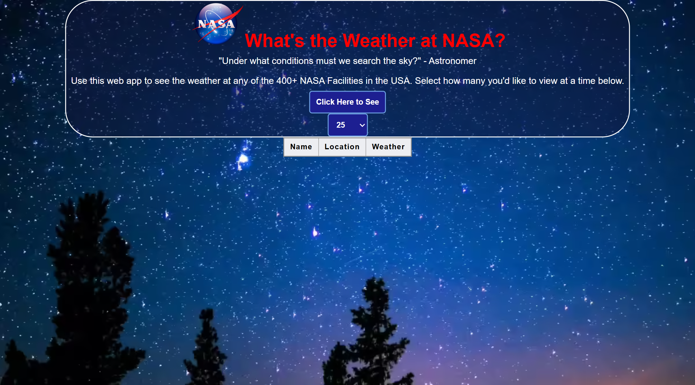

# 🚀 Project: Complex NASA API

### Goal: Use NASA's API to return all of their facility locations (~400). Display the name of the facility, its location, and the weather at the facility currently. 

## Project Description

Use this web app to see the weather at any of the 400+ NASA Facilities in the USA. It uses data.nasa.gov API and a cors.io prefix to locate all the NASA locations in the USA. These geographic coordinates are then sent to /api.weatherapi.com/ API to retrieve the current weather conditions and degrees in Fahrenheit.   

The application displays the NASA facility name and address, the current weather conditions of that location, and the degrees in Fahrenheit.  

## Tech Stack

- **HTML** 
- **CSS**
- **JavaScript**

## How to Run or View It

1. Clone or download the repository.
2. Open `index.html` in a browser or serve the project using a local development server.
3. Select how many facilities you would like to see at a time
4. Click **Click Here to See** to retrieve Facilities and their local weather

The application requires an internet connection to access its external APIs. API availability and credential requirements may affect the results.
/api.weatherapi.com/ requires a key

## Screenshots and Demo
Live Link: https://nasaweather.netlify.app/ 
### Application Interface

.png)

The interface displays the NASA facility name and address, the current weather conditions of that location, and the degrees in Fahrenheit. 