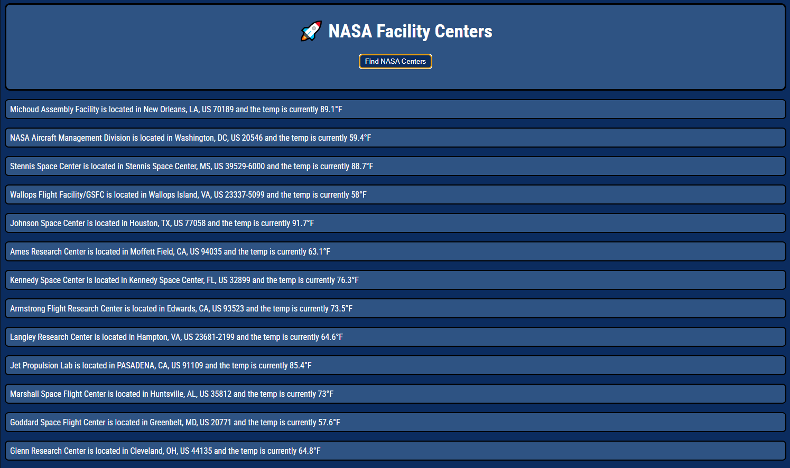

# NASA Facilities

A front-end web app that pulls in every NASA facility location (around 400) and displays each one's name, location, and current weather.

[Try it Here](https://exbrto.github.io/NASA-Facilities/)

## How It Works

This app chains two APIs together:

1. The app requests the full list of NASA facilities from **NASA's open data portal**.
2. For each facility, it takes the latitude and longitude from the NASA data.
3. Those coordinates are sent to **Open-Meteo**, which returns the current weather at that spot.
4. Each facility is displayed on the page with its **name**, **location** (city and state), and **current weather**.

## How It's Made

**Tech used:** HTML, CSS, JavaScript

**APIs:**
- [NASA Facilities dataset](https://data.nasa.gov/docs/legacy/gvk9-iz74.json): names and locations of NASA facilities (no API key needed)
- [Open-Meteo](https://open-meteo.com/): current weather for any coordinates (no API key needed)

The page is built with HTML and styled with CSS. JavaScript uses `fetch()` to get the facilities data, loops through the results, and uses each facility's coordinates to request its current weather from Open-Meteo. The facility info and weather are then added to the DOM.

