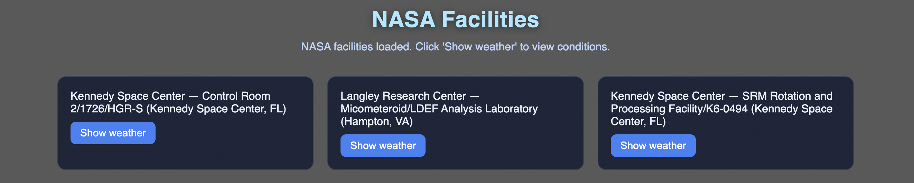

# 🌌 NASA Facilities + Current Weather

An interactive display of all NASA facilities across the United States, paired with live current weather data for each location.  
Built to explore large-scale public data handling and chained API requests, this project combines clean visuals with real-time information.

[Live Demo](https://complex-nasa-api.vercel.app/)

---

## How It’s Made
**Tech used:** HTML, CSS, JavaScript  

This project fetches NASA facility data through a CORS proxy and dynamically displays each location as a card with its name, city, and state.  
Each card includes a “Show weather” button that triggers a second fetch from the Open-Meteo API to display live conditions for that facility.  
The interface is styled with a dark cosmic theme inspired by NASA imagery and designed for easy readability across hundreds of results.

---

## Optimizations
- Add filters by state or region.  
- Introduce a search bar for faster navigation.  
- Include a “Hide weather” toggle.  
- Experiment with data caching or lazy loading.  
- Optionally visualize facility locations on a map.

---

## Lessons Learned
- Working with nested fetch requests between two public APIs.  
- Efficiently rendering large datasets with DOM manipulation.  
- Managing hidden elements that reveal on user interaction.  
- Maintaining clean, readable UI even with heavy data flow.  
- Simplifying chained API logic without complex frameworks.

