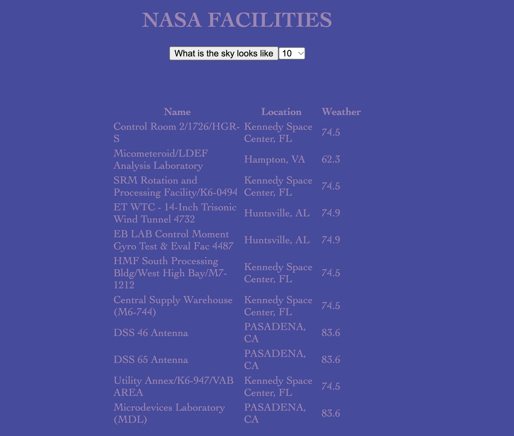

# NASA Facility Explorer

Explore NASA facility locations and request current weather information for their cities.

## About

NASA Facility Explorer is a front-end project that combines NASA facility data with weather information. Users select a list size and request a table showing facility names, locations, and temperatures.

Built for the Resilient Labs Complex NASA API challenge, this project practices working with multiple APIs, asynchronous JavaScript, and dynamic page updates.

## How it looks like
- Check it out: 
https://nasa-facility-etod.vercel.app/
- Screenshots:


## Features

- Request NASA facility data.
- Choose from list-size options of 10, 30, or 250.
- Display facility names, cities, and states.
- Request current temperatures for facility cities.
- Update an HTML table dynamically.

## Built With

- **HTML** — page structure and table layout
- **CSS** — styling
- **JavaScript** — interactions and DOM updates
- **Fetch API** — asynchronous data requests
- **NASA Open Data** — facility information
- **WeatherAPI** — current temperatures in Fahrenheit
- **cors.io** — proxy for the NASA data request

## How It Works

1. The user selects a list size and clicks the request button.
2. The app requests NASA facility data through a proxy.
3. Facility names and locations are added to the table.
4. A separate weather request is made for each facility’s city.
5. Temperatures are added as the weather responses arrive.

## Getting Started

Clone the project’s `answer` branch:

```bash
git clone --branch answer https://github.com/sabrinalindev/nasa-facility.git
cd nasa-facility
```

Open the folder in your editor and serve `index.html` using a local development server, such as VS Code Live Server.

No npm installation or build step is required. An internet connection and working API services are required to load data.

## Project Structure

```text
nasa-facility/
├── css/
│   └── style.css
├── js/
│   └── main.js
├── index.html
└── README.md
```

## Current Limitations

- The NASA request depends on a legacy endpoint and a third-party proxy.
- The weather endpoint currently uses HTTP, which can be blocked when the app is served over HTTPS.
- The loop includes index zero through the selected value, so it attempts to display one more facility than selected.
- Repeated requests append rows instead of replacing previous results.
- Errors are logged to the console rather than displayed on the page.

## Planned Improvements

- Replace the legacy NASA endpoint and proxy dependency.
- Use HTTPS for weather requests.
- Move weather credentials to a backend or serverless function.
- Correct the facility count and clear previous results.
- Add loading indicators and visible error messages.
- Reduce duplicate weather requests for facilities in the same city.
- Add search and filtering.

## Acknowledgments

- [NASA Open Data](https://data.nasa.gov/) for facility data.
- [WeatherAPI](https://www.weatherapi.com/) for weather information.
- [Resilient Labs](https://github.com/Resilient-Labs/complex-nasa-bootcamp) for the original challenge.

## Author

[Sabrina Lin](https://github.com/sabrinalindev)